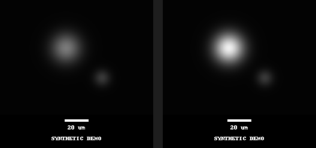

# Image Batch Processor

**Local, traceable microscopy display exports from 2D TIFFs.** Apply one explicit intensity range and crop to a batch, draw a calibrated scale bar without resampling, and keep a replayable record of every input and output.

[MIT license](LICENSE) · Python 3.10+ · Alpha



*Artificial Gaussian spots, not experimental data. The example's 0.5 µm/pixel calibration is fictional. Both panels use the same 1,000–40,000 raw intensity range, so the brighter source stays brighter.*

## Why this exists

A folder of figure exports is hard to audit if each image was adjusted separately or its settings were lost. `ibp-micro` is a small command-line workflow for a narrower job:

- One common, user-chosen linear display range and optional rectangular crop.
- Original TIFFs opened read-only; new output directory required; no overwriting.
- Unsigned 8/16-bit, single-channel, single-plane grayscale TIFF only.
- Square-pixel calibration supplied and explicitly confirmed by the user. TIFF resolution/OME calibration metadata is **not** used automatically.
- A scale bar in a separate footer, with exactly the requested integer number of pixels. No stretching, rotation, or interpolation.
- 8-bit display PNGs, JSON/CSV manifests, source/output SHA-256 hashes, software versions, and a hash-checked replay command.

**These PNGs are for display, not quantitative analysis.** Mapping to 8-bit clips and reduces intensity precision. Measure the original data. This is early-stage software, not validated scientific or clinical software. Passing tests does not establish the correctness of your acquisition calibration or the appropriateness of a figure.

## Install

```bash
git clone https://github.com/Master-626/image-batch-processor.git
cd image-batch-processor
python -m venv .venv
# macOS / Linux:
source .venv/bin/activate
# Windows PowerShell: .venv\Scripts\Activate.ps1
python -m pip install .
```

No account, upload, or network service is needed to process images. Installation may download dependencies. Install from this repository; a PyPI release is not assumed.

## Run the synthetic example

From the repository root, in a fresh working directory for these outputs:

```bash
python examples/generate_synthetic.py synthetic-input
ibp-micro export synthetic-input -o synthetic-export \
  --display-min 1000 --display-max 40000 \
  --pixel-size-um 0.5 --scale-bar-um 20 \
  --confirm-calibration --synthetic-data
```

The demo generates two **synthetic** 16-bit TIFFs, not real experiments. `--synthetic-data` adds a visible label to each output and records the flag in both manifests. On PowerShell, enter the command on one line instead of using `\` line continuations.

Output:

```text
synthetic-export/
  SYNTHETIC_spots_1.tif.png
  SYNTHETIC_spots_2.tif.png
  manifest.json
  manifest.csv
```

Only `.tif`/`.tiff` files directly in the input folder are selected. Subfolders and other file types are ignored. The original extension is retained in each PNG name so `sample.tif` and `sample.tiff` cannot overwrite each other.

## Use your own images

First verify that all images have the **same square-pixel calibration** from acquisition records or a validated calibration workflow. The flag is your confirmation; the software cannot verify it. Do not copy the demo calibration into a real experiment.

```bash
ibp-micro export raw-tiffs -o figure-export \
  --display-min 500 --display-max 30000 \
  --crop 40 20 512 384 \
  --pixel-size-um 0.1625 --scale-bar-um 13 \
  --confirm-calibration
```

Here the crop is `x=40, y=20, width=512, height=384`, in original pixels with zero-based coordinates. Every input must contain that crop. A 13 µm bar at 0.1625 µm/pixel is **80 pixels** wide. Noninteger bar widths are rejected instead of silently rounding the physical length.

The chosen intensity range is applied identically to every image. There is no per-image autoscaling or automatic percentile choice. For 8-bit TIFFs the maximum must be ≤255; for 16-bit TIFFs it must be ≤65535. Choose suitable limits for the data and report display adjustments when required by your field or journal.

The output image contains the crop at unchanged pixel dimensions, plus a 56-pixel black annotation footer. The bar occupies exactly the recorded number of horizontal pixels. Label and bar must fit within the crop width; otherwise export stops. The footer is outside the source image, so it does not hide image content. `manifest.json` records the image/footer boundaries and bar coordinates.

## Replay and audit

```bash
ibp-micro replay synthetic-input -o synthetic-replayed \
  --manifest synthetic-export/manifest.json --confirm-calibration
```

Replay checks the full TIFF filename set and SHA-256 of each source, reapplies the recorded settings, and requires an identical PNG SHA-256. Changed/missing/extra TIFFs or different rendered PNGs cause failure. It does not fetch original data. Keep the original TIFFs, manifest, and software environment together.

The JSON manifest records raw-source and exported-file hashes, image dimensions and bit depth, crop, display range, scale bar, user-confirmed calibration, synthetic-data status, and Python/NumPy/Pillow/tifffile/zlib versions. CSV is a compact audit summary; JSON is the replay recipe. Manifests contain source **basenames**, not absolute paths or copied TIFF metadata. Filenames themselves can be sensitive; review them before sharing.

Runs are deterministic in the same software environment. A library change can change PNG bytes even if pixels look identical; replay refuses the mismatch and asks you to use the recorded versions. The manifest is not a signed authenticity certificate. Do not trust a modified manifest just because its hashes match.

## Supported scope and failures

Rejected explicitly:

- RGB, palette, MINISWHITE, floating-point, signed, packed-bit, multichannel, multipage, Z/time stacks, pyramids/SubIFDs, or non-`YX` axes.
- Non-top-left TIFF orientation; this tool will not silently rotate a source.
- Source files over 256 MiB or images over 50 megapixels.
- Input/output overlap, existing output folders, TIFF symbolic links, case-insensitive filename collisions, and formula-like/control-character filenames unsafe for CSV.
- Unconfirmed/nonpositive calibration, invalid display ranges, crops outside any source, or bars/labels that do not fit.

Compressed TIFF support depends on the installed decoder. The minimal install does not include `imagecodecs`; unsupported compression fails with a decoding error. Export an uncompressed 2D TIFF from your acquisition tool if needed. Proprietary microscope formats are out of scope.

Processing is sequential and uses a full-file/decoded-image snapshot in memory. On a handled error, the newly created output directory is removed; existing files are never reused. A forced process termination or machine failure can leave an incomplete folder. `manifest.json` is written last as the completion marker; remove or rename an incomplete folder yourself before retrying. Do not modify inputs or the output folder while a run is active.

## Existing general image command

The original `ibp` / `image-batch-processor` CLI and Python API remain available for ordinary photos:

```bash
ibp photos -o resized --scale 0.5 --format png
ibp --help
```

These legacy resize/rotate/watermark tools are **not the microscopy workflow** and do not provide its provenance/calibration safeguards. Use separate input/output folders and backups. The legacy `--workers` argument is retained for compatibility, but processing is sequential. The earlier concurrency claim has been removed.

## Development

```bash
python -m pip install -e ".[dev]"
python -m pytest -q
python -m build
```

Tests use generated artificial arrays only. They cover exact intensity mapping, crop/bar geometry, original-file preservation, byte-identical replay, changed source/output hashes, invalid calibration, malformed TIFFs, unsupported dimensions/types, filename collisions, output protection, and legacy image operations. CI is configured for Python 3.10/3.12 on Linux, Windows, and macOS; check the actual run before assuming a platform has passed.

See [CONTRIBUTING.md](CONTRIBUTING.md) for small, testable contributions and [the validation notes](docs/validation.md) for scope and reproducibility details.

## Related tools

This is not a claim of a new research method or a replacement for established microscopy tooling. [OMERO.figure](https://omero.figure.openmicroscopy.org/) offers figure preparation in the OMERO ecosystem; other batch workflows, including micrograph-batch, overlap with this area. Choose an established tool when you need richer formats, metadata handling, interactive figure layouts, or an existing laboratory workflow.

## License

[MIT](LICENSE). No real experimental images are included in this repository.
